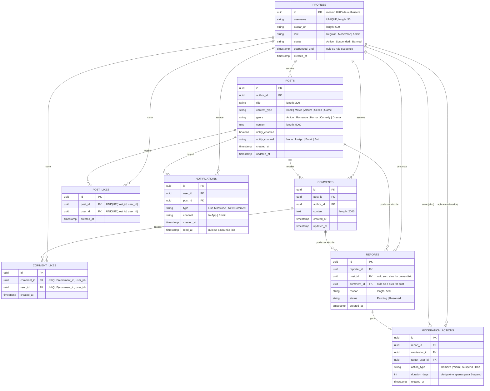
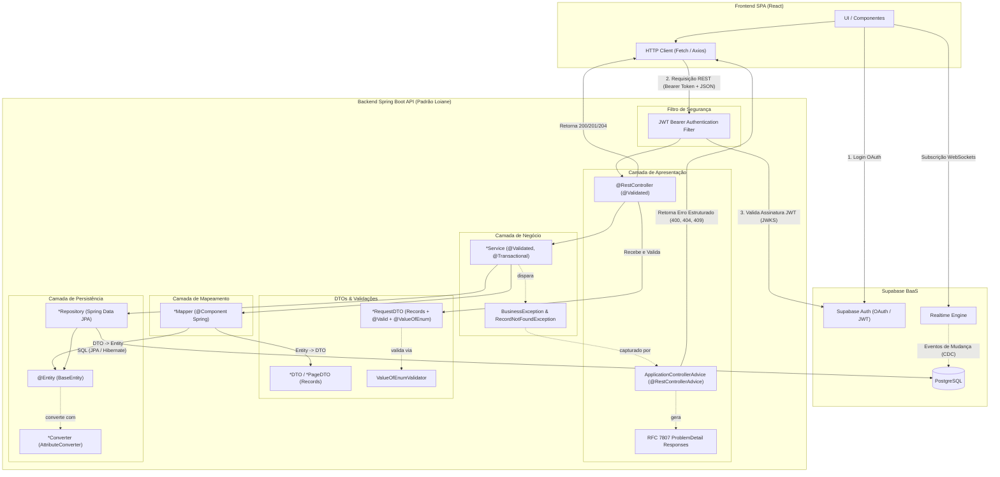
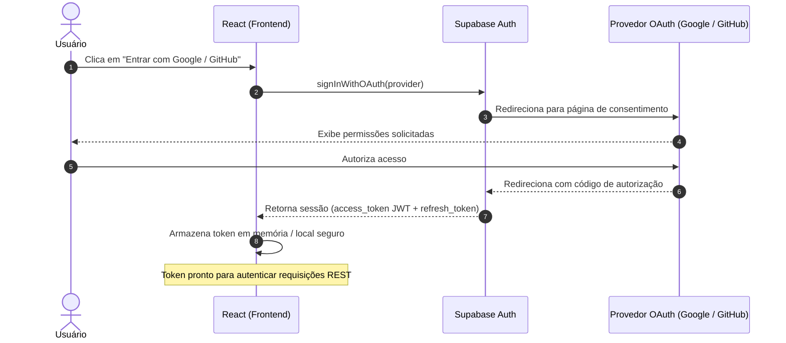
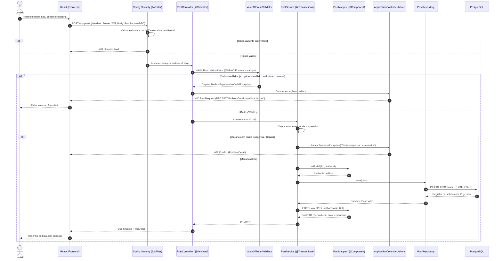
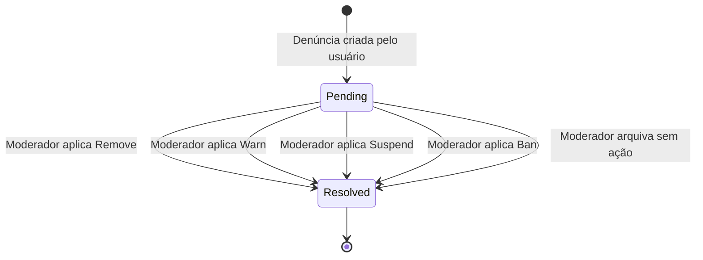
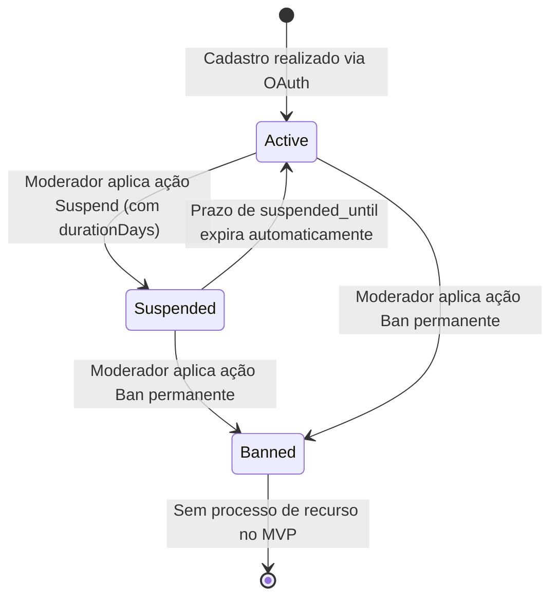
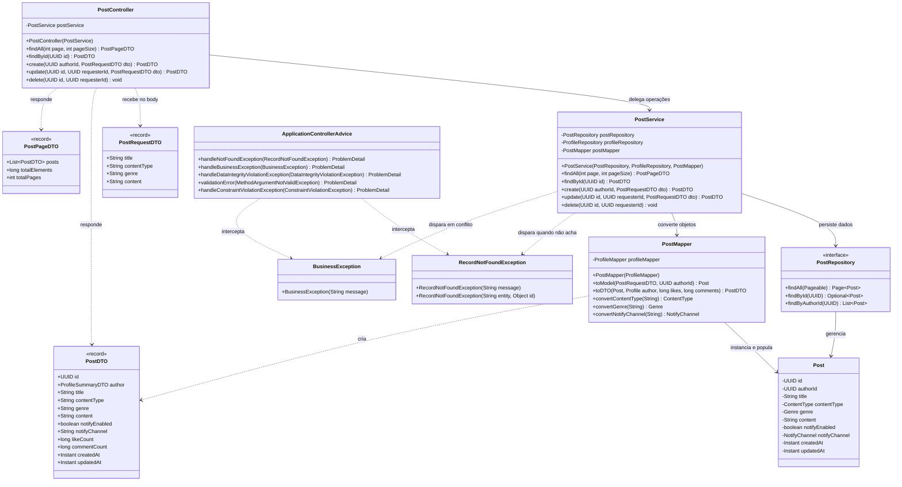

# Diagramas — ReviewIt (Padrão crud-angular-spring)

> Diagramas atualizados em sintaxe [Mermaid](https://mermaid.js.org), alinhados rigorosamente com a modelagem do documento `entidades-dtos-reviewit-updated.md` e o padrão arquitetural de referência do **`crud-angular-spring`** (Loiane Groner).
> Inclui enums em inglês com valores amigáveis via `getValue()`, Mappers `@Component`, DTOs records, tratamento de erro RFC 7807 (`ProblemDetail`) e convenções do ecossistema Spring Boot 3+.

---

## 1. Diagrama de Entidade-Relacionamento (DER)

Modela as tabelas do backend no PostgreSQL (via Supabase). O vínculo com o serviço de autenticação (`auth.users`) é feito na tabela `profiles` através do mesmo UUID. Os valores enumerados refletem as strings salvas no banco pelos respectivos `AttributeConverter`.

### Regras e Constraints de Banco:
- **`uk_post_user` e `uk_comment_user`**: Constraints `UNIQUE(post_id, user_id)` e `UNIQUE(comment_id, user_id)` impedem curtidas duplicadas diretamente na camada de persistência (RF17).
- **Check Constraint em `REPORTS`**: `CHECK ((post_id IS NOT NULL AND comment_id IS NULL) OR (post_id IS NULL AND comment_id IS NOT NULL))`, garantindo que uma denúncia aponte para um post OU um comentário, nunca ambos ou nenhum.
- **Portabilidade**: Colunas de texto utilizam `@Column(length = ...)` para compatibilidade transparente entre H2 em desenvolvimento/testes e PostgreSQL em produção.

---

## 2. Diagrama de Arquitetura de Componentes

Visão detalhada da arquitetura baseada no padrão `crud-angular-spring`:

---

## 3. Diagrama de Sequência — Autenticação OAuth

Mostra a interação inicial entre o usuário, frontend e o Supabase Auth antes de qualquer chamada autenticada ao backend.

---

## 4. Diagrama de Sequência — Criar Post (Fluxo com Validação e RFC 7807)

Mostra a requisição autenticada, validação em múltiplas etapas, tratamento de erros via `ApplicationControllerAdvice` e retorno padronizado no molde do `crud-angular-spring`.

---

## 5. Diagramas de Estados

### 5.1 Ciclo de Vida da Denúncia (`ReportStatus`)

### 5.2 Ciclo de Vida da Conta do Usuário (`AccountStatus`)

---

## 6. Diagrama de Classes: Arquitetura em Camadas (Domínio Post)

Detalha as classes, anotações, injeções de dependência e responsabilidades no padrão exato do `crud-angular-spring`.

---

## 7. Diagrama de Classes: Entidades JPA e Enums com Converters

Ilustra as entidades Java, o modelo de herança com `BaseEntity`, os tipos de Enum com seus métodos e o padrão de `AttributeConverter`.

```mermaid
classDiagram
    direction TB

    class BaseEntity {
        <<MappedSuperclass>>
        #UUID id
        #Instant createdAt
        +getId() UUID
        +getCreatedAt() Instant
    }

    class Profile {
        -UUID id
        -String username
        -String avatarUrl
        -Role role
        -AccountStatus status
        -Instant suspendedUntil
        -Instant createdAt
    }

    class Post {
        -UUID authorId
        -String title
        -ContentType contentType
        -Genre genre
        -String content
        -boolean notifyEnabled
        -NotifyChannel notifyChannel
        -Instant updatedAt
    }

    class Comment {
        -UUID postId
        -UUID authorId
        -String content
        -Instant updatedAt
    }

    class PostLike {
        -UUID postId
        -UUID userId
    }

    class CommentLike {
        -UUID commentId
        -UUID userId
    }

    class Report {
        -UUID reporterId
        -UUID postId
        -UUID commentId
        -String reason
        -ReportStatus status
    }

    class ModerationAction {
        -UUID reportId
        -UUID moderatorId
        -UUID targetUserId
        -ActionType actionType
        -Integer durationDays
    }

    class Notification {
        -UUID userId
        -UUID postId
        -NotificationType type
        -DeliveryChannel channel
        -Instant readAt
    }

    %% Enums
    class Role {
        <<enumeration>>
        REGULAR("Regular")
        MODERATOR("Moderator")
        ADMIN("Admin")
        -String value
        +getValue() String
        +fromValue(String)$ Role
        +toString() String
    }

    class AccountStatus {
        <<enumeration>>
        ACTIVE("Active")
        SUSPENDED("Suspended")
        BANNED("Banned")
        -String value
        +getValue() String
        +fromValue(String)$ AccountStatus
        +toString() String
    }

    class ContentType {
        <<enumeration>>
        BOOK("Book")
        MOVIE("Movie")
        ALBUM("Album")
        SERIES("Series")
        GAME("Game")
        -String value
        +getValue() String
        +fromValue(String)$ ContentType
        +toString() String
    }

    class Genre {
        <<enumeration>>
        ACTION("Action")
        ROMANCE("Romance")
        HORROR("Horror")
        COMEDY("Comedy")
        DRAMA("Drama")
        -String value
        +getValue() String
        +fromValue(String)$ Genre
        +toString() String
    }

    class NotifyChannel {
        <<enumeration>>
        NONE("None")
        IN_APP("In-App")
        EMAIL("Email")
        BOTH("Both")
        -String value
        +getValue() String
        +fromValue(String)$ NotifyChannel
        +toString() String
    }

    class ReportStatus {
        <<enumeration>>
        PENDING("Pending")
        RESOLVED("Resolved")
        -String value
        +getValue() String
        +fromValue(String)$ ReportStatus
        +toString() String
    }

    class ActionType {
        <<enumeration>>
        REMOVE("Remove")
        WARN("Warn")
        SUSPEND("Suspend")
        BAN("Ban")
        -String value
        +getValue() String
        +fromValue(String)$ ActionType
        +toString() String
    }

    class NotificationType {
        <<enumeration>>
        LIKE_MILESTONE("Like Milestone")
        NEW_COMMENT("New Comment")
        -String value
        +getValue() String
        +fromValue(String)$ NotificationType
        +toString() String
    }

    class DeliveryChannel {
        <<enumeration>>
        IN_APP("In-App")
        EMAIL("Email")
        -String value
        +getValue() String
        +fromValue(String)$ DeliveryChannel
        +toString() String
    }

    %% Converters
    class RoleConverter {
        <<Converter>>
        +convertToDatabaseColumn(Role) String
        +convertToEntityAttribute(String) Role
    }

    class AccountStatusConverter {
        <<Converter>>
        +convertToDatabaseColumn(AccountStatus) String
        +convertToEntityAttribute(String) AccountStatus
    }

    class ContentTypeConverter {
        <<Converter>>
        +convertToDatabaseColumn(ContentType) String
        +convertToEntityAttribute(String) ContentType
    }

    class GenreConverter {
        <<Converter>>
        +convertToDatabaseColumn(Genre) String
        +convertToEntityAttribute(String) Genre
    }

    class NotifyChannelConverter {
        <<Converter>>
        +convertToDatabaseColumn(NotifyChannel) String
        +convertToEntityAttribute(String) NotifyChannel
    }

    class ReportStatusConverter {
        <<Converter>>
        +convertToDatabaseColumn(ReportStatus) String
        +convertToEntityAttribute(String) ReportStatus
    }

    class ActionTypeConverter {
        <<Converter>>
        +convertToDatabaseColumn(ActionType) String
        +convertToEntityAttribute(String) ActionType
    }

    class NotificationTypeConverter {
        <<Converter>>
        +convertToDatabaseColumn(NotificationType) String
        +convertToEntityAttribute(String) NotificationType
    }

    class DeliveryChannelConverter {
        <<Converter>>
        +convertToDatabaseColumn(DeliveryChannel) String
        +convertToEntityAttribute(String) DeliveryChannel
    }

    %% Relações de Herança
    BaseEntity <|-- Post
    BaseEntity <|-- Comment
    BaseEntity <|-- PostLike
    BaseEntity <|-- CommentLike
    BaseEntity <|-- Report
    BaseEntity <|-- ModerationAction
    BaseEntity <|-- Notification

    %% Vínculos Lógicos por ID
    Post ..> Profile : authorId
    Comment ..> Profile : authorId
    Comment ..> Post : postId
    PostLike ..> Post : postId
    PostLike ..> Profile : userId
    CommentLike ..> Comment : commentId
    CommentLike ..> Profile : userId
    Report ..> Profile : reporterId
    Report ..> Post : postId (opcional)
    Report ..> Comment : commentId (opcional)
    ModerationAction ..> Report : reportId
    ModerationAction ..> Profile : moderatorId, targetUserId
    Notification ..> Profile : userId
    Notification ..> Post : postId

    %% Uso dos Enums nas Entidades
    Profile --> Role
    Profile --> AccountStatus
    Post --> ContentType
    Post --> Genre
    Post --> NotifyChannel
    Report --> ReportStatus
    ModerationAction --> ActionType
    Notification --> NotificationType
    Notification --> DeliveryChannel

    %% Conexão com os Converters
    RoleConverter ..> Role : converte
    AccountStatusConverter ..> AccountStatus : converte
    ContentTypeConverter ..> ContentType : converte
    GenreConverter ..> Genre : converte
    NotifyChannelConverter ..> NotifyChannel : converte
    ReportStatusConverter ..> ReportStatus : converte
    ActionTypeConverter ..> ActionType : converte
    NotificationTypeConverter ..> NotificationType : converte
    DeliveryChannelConverter ..> DeliveryChannel : converte
```

